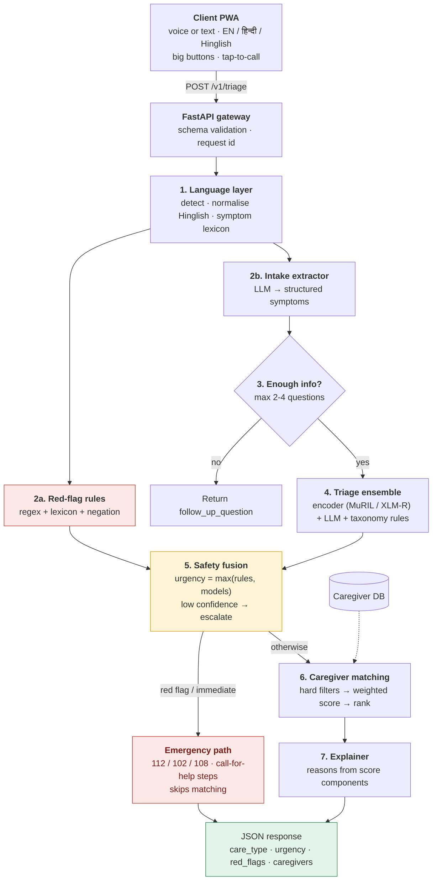

# CareCompass — Architecture

Derived from `problem_statement.md` (HACK IIITD). Safety-first, API-first, hybrid (rules + ML + LLM).

## 1. Design principles
1. **Safety is deterministic.** A rule-based red-flag engine runs *before and after* any model. Final urgency = max(rules, models). Under-triage is the costliest error (20% of score + "cannot win" clause).
2. **API-first, stateless.** One `POST /v1/triage` matching the published JSON schema; the client sends `conversation_history`. UI is just a client.
3. **Graceful degradation.** LLM down/slow/unsure -> classifier + rules -> conservative escalation. Never return nothing.
4. **Route, don't diagnose.** No disease names or prescriptions in outputs; reasons talk about symptoms, duration, severity.
5. **Explainability by construction.** Reasons are generated from the features that actually drove the decision, not post-hoc prose.

## 2. System overview



## 3. Components

| # | Component | Responsibility | Default choice |
|---|---|---|---|
| 1 | Language layer | Detect language, normalise Hinglish spellings, map to canonical symptom terms | `langdetect`/fastText + custom lexicon; indic-transliteration |
| 2a | Red-flag engine | High-recall detection: chest pain, breathlessness, unconsciousness, seizure, heavy bleeding, stroke signs (face/arm/speech), severe allergic reaction, poisoning, pregnancy bleeding, infant lethargy, suicidal intent | YAML rules + negation ("no breathing difficulty") + age modifiers |
| 2b | Intake extractor | Free text -> structured JSON (symptoms, duration, severity, patient age/sex, red-flag answers) | LLM with JSON schema; regex fallback |
| 3 | Follow-up policy | Ask only what changes the decision; 2-4 max | Rule table of required slots per symptom cluster; later: expected-information-gain |
| 4 | Triage ensemble | `care_type`, `urgency`, confidence | Fine-tuned encoder + LLM vote; calibrated probabilities |
| 5 | Safety fusion | Never lower urgency below rules; escalate on low confidence | Cost-sensitive thresholds tuned on emergency recall |
| 6 | Matcher | Rank caregivers | Hard filters + weighted score (see below) |
| 7 | Explainer | Plain-language reasons in user's language | Template + score components |

### Matching score
```
score = w_skill*skill_fit + w_dist*f(distance) + w_avail*slot_fit(urgency)
      + w_lang*language_match + w_rating*norm_rating
```
Start with `skill .30, availability .25, distance .20, language .15, rating .10`; tune against any expert-judged examples. `slot_fit` is urgency-aware (same-day needs a slot within hours, routine tolerates days). `distance` is haversine, later road ETA. Reason string comes from the top two components, e.g. "Hindi-speaking, 3 km away, free at 4 pm".

## 4. API contract (matches indicative schema)
- `POST /v1/triage` -> `{follow_up_question, care_type, urgency, red_flags[], reasoning, matched_caregivers[{caregiver_id, score, reason}]}`
- `POST /v1/transcribe` (audio -> text), `POST /v1/book` (caregiver_id + slot), `GET /v1/caregivers/{id}`, `GET /healthz`
- Extra, non-breaking fields (e.g. `confidence`, `emergency_instructions`, `trace_id`) go under an `x_` prefix so auto-scoring is unaffected.
- `predict.py` batch script: hidden-test CSV in -> predictions CSV out, using the same code path as the API.

## 5. Safety design
- Red-flag list from the provided care taxonomy is the source of truth; extend with mentor input.
- Negation and temporal handling ("pehle tha, ab nahi").
- Vulnerable-group bump: infants, elderly, pregnancy, known chronic disease raise urgency one level for borderline cases.
- Abstain rule: confidence below threshold -> escalate rather than guess; if still unclear, ask one more question, else escalate.
- Emergency screen: big red, tap-to-call 112/102/108, "do not wait for the app", simple first-aid-free instructions (stay with patient, unlock door, send location).
- Evaluate with **emergency recall as a gate** (target ~100% on train/val) before optimising macro-F1.
- DPDP: synthetic data only, consent banner, no raw text in logs, trace stores labels and rule hits only.

## 6. Data and training
- Provided vignettes: stratified split by care_type x urgency; keep a frozen dev set.
- Augment Hinglish: transliteration variants, spelling noise, code-mixing, paraphrases (LLM-generated, doctor-checked where possible); cite any public datasets.
- Model: fine-tune MuRIL or XLM-R with class weights / focal loss, two heads (care_type, urgency). Calibrate with temperature scaling.
- Metrics dashboard: macro-F1 per head, confusion matrices, emergency recall, mean follow-ups per case, p95 latency.

## 7. Frontend (elderly / low-literacy first)
- Single-screen flow: big mic button -> transcript confirmation -> one question at a time with large Yes/No/Not-sure buttons -> result card -> one-tap book.
- Language switcher (EN / हिन्दी / Hinglish) with spoken prompts; icons for symptoms; font >= 18px; high contrast.
- Result card: care type in plain words, urgency colour, "why" in one sentence, top caregiver with photo, distance, time, language.

## 8. Deployment
`docker-compose`: `api` (FastAPI), `web` (Next.js), `db` (SQLite file or Postgres), optional `asr` (faster-whisper). Config via `.env`; models downloaded at build. Target p95 < 2 s without LLM call path, < 5 s with.

## 9. Suggested repo layout
```
carecompass/
  api/        app.py, schemas.py, routes/
  core/       language.py, redflags.py, extractor.py, followup.py, triage.py, fusion.py, matcher.py, explain.py
  data/       taxonomy.yaml, redflags.yaml, lexicon_hinglish.yaml, caregivers.csv
  ml/         train.py, eval.py, predict.py
  web/        (Next.js PWA)
  tests/      test_redflags.py, test_api_schema.py, test_matcher.py
  docker-compose.yml, README.md, WRITEUP.md
```

## 10. Options and trade-offs

| Decision | Option A | Option B | Option C (recommended) |
|---|---|---|---|
| Triage brain | LLM-only: fastest to build, flexible, but inconsistent and slower, weaker on recall | Fine-tuned encoder + rules: fast, reproducible, great macro-F1 if data is decent, weaker on odd phrasing | **Hybrid**: encoder + LLM vote + rule override |
| LLM | Hosted API (Claude/GPT/Gemini): best quality, cost + network risk | Open model via Ollama/vLLM (Qwen2.5, Llama 3.1, Gemma): offline demo-safe, weaker Hinglish | Hosted primary, open-model fallback |
| ASR | Browser Web Speech API: zero setup, Chrome-only | Whisper / faster-whisper: robust Hinglish, needs compute | AI4Bharat IndicConformer or Bhashini for Hindi-first; Whisper fallback |
| Follow-ups | Fixed question table per symptom cluster | LLM-generated questions | Table + expected-information-gain ranking (helps the "fewest questions" tie-break) |
| Matching | Weighted score | Learning-to-rank | Weighted score, LTR only if expert labels exist |
| Frontend | Streamlit/Gradio: hours, less polished | React/Next PWA: best UX score | Next.js PWA |
| Store | SQLite | Postgres + PostGIS | SQLite for demo, Postgres in write-up roadmap |

## 11. Extra ideas to stand out
1. **Confidence-aware UI**: show "We're not fully sure, so we suggest a nurse now" rather than silent guesses.
2. **WhatsApp / IVR channel** using the same API (huge for low-literacy users); even a stubbed Twilio demo lands well.
3. **Family profiles**: "Papa" remembered with age and conditions, improving later triage.
4. **Voice-first read-back**: app speaks the plan in Hindi and asks for confirmation.
5. **Photo input** (rash, wound) as optional input routed to the same extractor via a vision model, with no diagnosis shown.
6. **Caregiver fallback ladder**: if nobody fits the slot, offer teleconsult now plus home visit later.
7. **Safety test-suite as a deliverable**: 100+ adversarial red-flag phrases (negations, slang, mixed script) published in the repo; judges see rigor.
8. **Ablation table in the write-up**: rules only vs classifier vs LLM vs hybrid, with emergency recall per row.
9. **Live ops dashboard**: queue of triaged cases by urgency, demonstrating the "live app" tie-break.
10. **Offline/low-bandwidth mode**: on-device rule engine runs red-flag check even without network.

## 12. Build plan (hackathon-sized)
1. Hour 0-3: schemas, FastAPI skeleton, caregiver loader, red-flag engine, stub UI.
2. Hour 3-8: baseline classifier + eval script; matcher + explainer.
3. Hour 8-14: LLM extractor/follow-up, fusion, Hinglish augmentation, voice.
4. Hour 14-20: PWA polish, emergency screen, Docker, predict.py CSV.
5. Final: safety test-suite, ablations, 2-page write-up, 3-min demo video.
