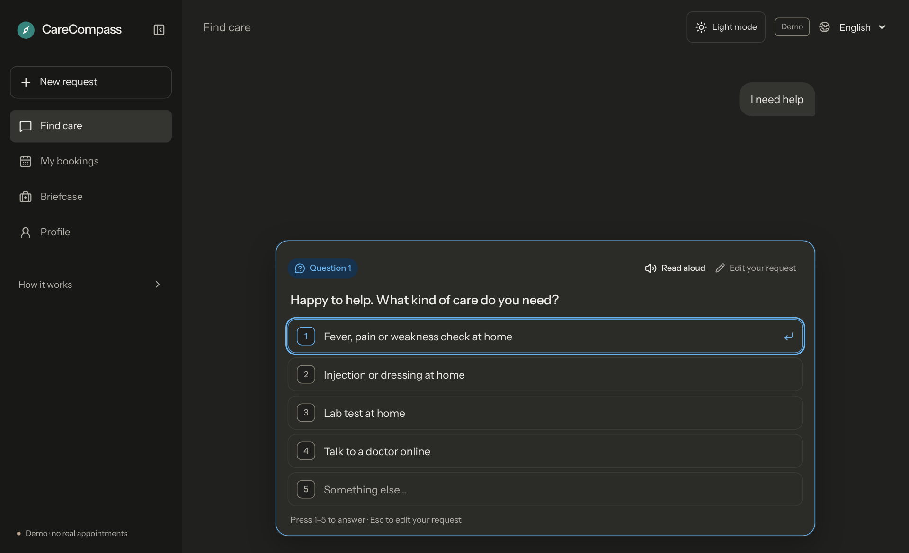
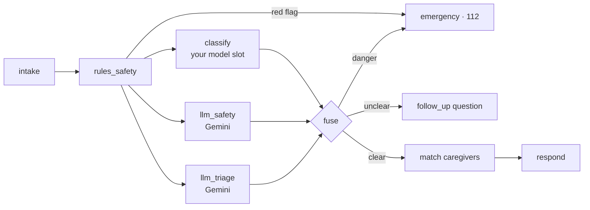
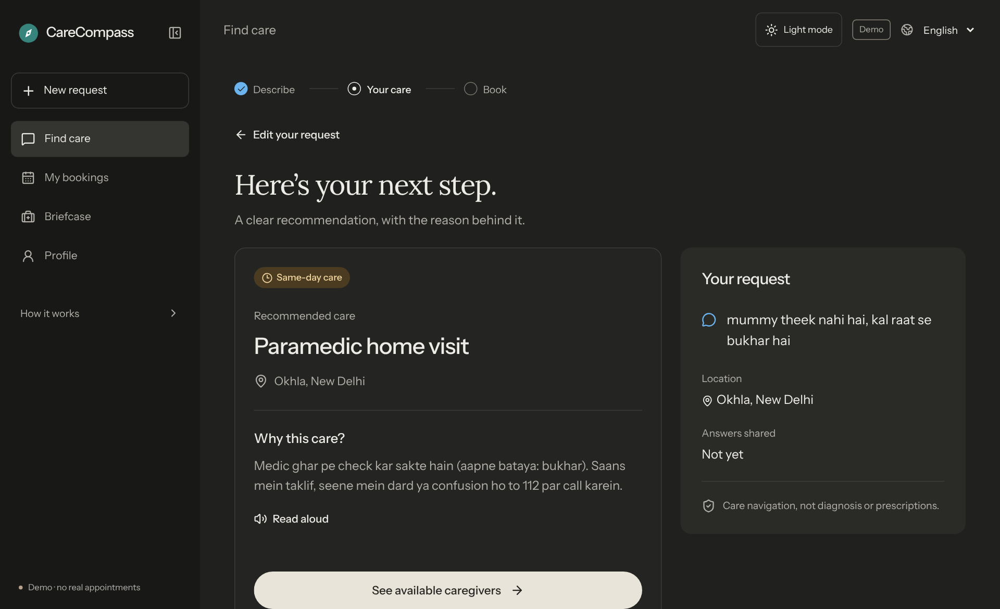
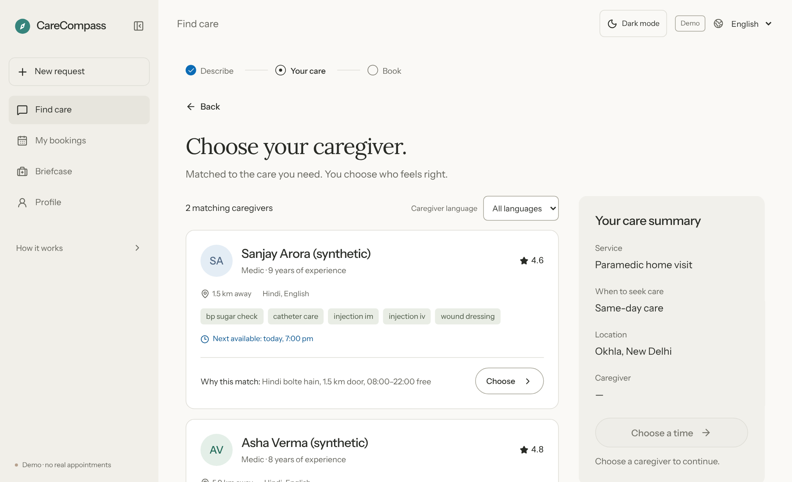
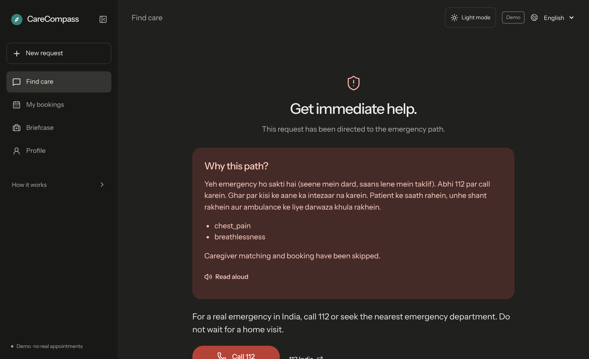

<a id="readme-top"></a>

<!-- PROJECT SHIELDS -->
<div align="center">

[![Issues][issues-shield]][issues-url]
[![MIT License][license-shield]][license-url]
[![Tests][tests-shield]][tests-url]
[![Emergency recall][recall-shield]][eval-url]

</div>

<!-- PROJECT LOGO -->
<br />
<div align="center">
  <a href="https://github.com/dipesh4000/CareCompass-HackIIITD">
    
  </a>

  <h3 align="center">CareCompass</h3>

  <p align="center">
    Describe a health need in English, Hindi or Hinglish. Get the right kind of care, how urgent it is, and a caregiver who can actually come.
    <br />
    Built for <b>HACK IIITD</b> (CAI, IIIT-Delhi)
    <br />
    <br />
    <a href="backend/README.md"><strong>Explore the docs »</strong></a>
    ·
    <a href="https://github.com/dipesh4000/CareCompass-HackIIITD/issues/new?labels=bug">Report Bug</a>
    ·
    <a href="https://github.com/dipesh4000/CareCompass-HackIIITD/issues/new?labels=enhancement">Request Feature</a>
  </p>
</div>

<!-- TABLE OF CONTENTS -->
<details>
  <summary>Table of Contents</summary>
  <ol>
    <li>
      <a href="#about-the-project">About The Project</a>
      <ul>
        <li><a href="#built-with">Built With</a></li>
        <li><a href="#how-it-works">How It Works</a></li>
      </ul>
    </li>
    <li>
      <a href="#getting-started">Getting Started</a>
      <ul>
        <li><a href="#prerequisites">Prerequisites</a></li>
        <li><a href="#installation">Installation</a></li>
      </ul>
    </li>
    <li><a href="#usage">Usage</a></li>
    <li><a href="#caregiver-scoring">Caregiver Scoring</a></li>
    <li><a href="#evaluation">Evaluation</a></li>
    <li><a href="#api">API</a></li>
    <li><a href="#roadmap">Roadmap</a></li>
    <li><a href="#contributing">Contributing</a></li>
    <li><a href="#license">License</a></li>
    <li><a href="#acknowledgments">Acknowledgments</a></li>
  </ol>
</details>

<!-- ABOUT THE PROJECT -->
## About The Project

<p align="center">
  
  <br />
  <sub>One clear question when the message is vague.</sub>
</p>

A family types something like *"mummy theek nahi hai, kal raat se bukhar hai"*. CareCompass:

1. **Checks for emergencies first.** Chest pain, trouble breathing, collapse, heavy bleeding and similar red flags go straight to **112**. No home visit, no caregivers.
2. **Asks one clear question** when the message is vague ("I need help"), instead of guessing.
3. **Picks the care type and urgency**: paramedic home visit, home nursing, lab test at home, teleconsultation or 112.
4. **Matches caregivers** who speak the family's language, live nearby, are free and have the right skill.
5. **Explains every decision** in plain words.

**Safety contract**

- Deterministic rules run **first** and cannot be overridden.
- Any source (rules, your model, Gemini) can escalate to 112. **None can de-escalate.**
- A *possible* red flag triggers one danger-sign question, or escalates when the question budget (2) is spent.
- If Gemini fails, times out or breaks the schema, the rules answer instead.

<p align="right">(<a href="#readme-top">back to top</a>)</p>

### Built With

[![React][react-shield]][react-url]
[![Vite][vite-shield]][vite-url]
[![TypeScript][ts-shield]][ts-url]
[![FastAPI][fastapi-shield]][fastapi-url]
[![LangGraph][langgraph-shield]][langgraph-url]
[![Pydantic][pydantic-shield]][pydantic-url]
[![Gemini][gemini-shield]][gemini-url]
[![uv][uv-shield]][uv-url]

<p align="right">(<a href="#readme-top">back to top</a>)</p>

### How It Works



A **LangGraph** pipeline with two versioned system prompts (`backend/app/prompts/`): a *safety screener* that only hunts for red flags, and a *triage analyst* that picks the service, skills and plain-language reasoning. Both treat the user's text and profile as untrusted input.

The **deterministic classifier slot** is rules today. A trained model plugs in through the same interface (`ROUTER_BACKEND`), and Gemini stays as the second opinion. How the two are weighed is a setting (`FUSION_POLICY`: `llm_first`, `model_first`, `agree_or_ask`).

**Schemas are enforced both ways.** Gemini output is validated by strict Pydantic models (closed enums, no unknown keys) and anything invalid falls back to rules. API responses are checked against the organiser contract before they leave the server.

<p align="right">(<a href="#readme-top">back to top</a>)</p>

<!-- GETTING STARTED -->
## Getting Started

### Prerequisites

* [uv](https://docs.astral.sh/uv/) for the backend
  ```sh
  # macOS / Linux
  curl -LsSf https://astral.sh/uv/install.sh | sh
  # Windows (PowerShell)
  powershell -c "irm https://astral.sh/uv/install.ps1 | iex"
  ```
* Node.js 24 LTS for the frontend

### Installation

1. Clone the repo
   ```sh
   git clone https://github.com/dipesh4000/CareCompass-HackIIITD.git
   cd CareCompass-HackIIITD
   ```
2. Start the backend
   ```sh
   cd backend
   uv sync
   cp .env.example .env     # optional: add GEMINI_API_KEY, otherwise the rules path runs
   uv run uvicorn app.main:app --reload
   ```
   API docs are at http://127.0.0.1:8000/docs
3. Start the frontend in a second terminal
   ```sh
   cd frontend
   npm install
   VITE_API_BASE_URL=http://127.0.0.1:8000 npm run dev
   ```
   On PowerShell: `$env:VITE_API_BASE_URL="http://127.0.0.1:8000"; npm run dev`. Leave the variable unset for the offline demo. The app opens at http://127.0.0.1:5173
4. Run the tests (89, no network)
   ```sh
   cd backend && uv run pytest -q
   ```

<p align="right">(<a href="#readme-top">back to top</a>)</p>

### Sarvam voice

**To activate Sarvam:** add `SARVAM_API_KEY` to the prepared, git-ignored `frontend/.env.local`, restart the frontend, and reload.

For a fresh clone, copy `frontend/.env.example` to `frontend/.env.local` first. See [voice setup](frontend/VOICE.md) for local and Vercel configuration. The key stays server-side; no Python backend speech changes are required.

<!-- USAGE -->
## Usage

Type a request, answer at most a couple of questions (press `1`–`5`, or choose *Something else…*), then pick a caregiver. The app also has a dark theme, switched from the header.

<table>
  <tr>
    <td width="50%"></td>
    <td width="50%"></td>
  </tr>
  <tr>
    <td align="center"><sub><b>A recommendation with the reason behind it</b>, in the language the family wrote in.</sub></td>
    <td align="center"><sub><b>Caregivers ranked and explained</b>: language, distance, free slot and skills.</sub></td>
  </tr>
</table>

<p align="center">
  
  <br />
  <sub><b>Emergencies never reach a booking.</b> The red flags found are listed and matching is skipped.</sub>
</p>

The frontend walkthrough (Briefcase, health services, profile) is in [`frontend/README.md`](frontend/README.md).

<p align="right">(<a href="#readme-top">back to top</a>)</p>

<!-- SCORING -->
## Caregiver Scoring

Hard filters first. Anyone who fails one is never shown: active, right role, has every required skill, within their service radius, free in the needed window.

Then a weighted score, using the organiser's baseline weights so results are comparable:

| Factor | Weight | How it is computed |
|---|---|---|
| Language | 0.35 | 1 if they speak the family's language |
| Proximity | 0.30 | 1 − distance ÷ service radius (skipped for teleconsultation) |
| Skill | 0.20 | 0.85 × share of needed skills covered + 0.15 × tier |
| Rating | 0.15 | rating ÷ 5 |

Ties go to whoever is free sooner.

<p align="right">(<a href="#readme-top">back to top</a>)</p>

<!-- EVALUATION -->
## Evaluation

52 hand-written cases across English, Hindi and Hinglish, rules only (no LLM). Run `uv run python -m eval.run_eval` in `backend/`. It exits with an error if any emergency is missed.

| Metric | Result |
|---|---|
| Emergency recall | **100%** (21/21) |
| False alarms | 3.2% |
| Care-type accuracy | 97.9% |
| Asked a question on vague input | 4/4 |
| Picks with the required skill | 100% (organiser baseline 87.5%) |
| Picks free at 8:45 pm | 100% (organiser baseline 85.7%) |

> These cases were written and tuned by the team, so read the numbers as a regression check, not proof of real-world accuracy. The red-flag list, the 112 number and the Tele-MANAS helpline still need confirming with the mentors.

<p align="right">(<a href="#readme-top">back to top</a>)</p>

<!-- API -->
## API

| Endpoint | Purpose |
|---|---|
| `POST /api/v1/triage` | Organiser contract: `{user_input, language, location, conversation_history}` → care type, urgency, red flags, reasoning, matched caregivers |
| `POST /api/v1/triage/trace` | Same decision, plus a plain-words trace of every graph step |
| `GET /api/v1/caregivers` | Browse caregivers, filterable by `care_type` |
| `GET /api/v1/graph` | The LangGraph flow as Mermaid |
| `GET /health` | Classifier, LLM, ruleset and fusion policy in use |

Config, fusion policy, prompts and schema enforcement are covered in [`backend/README.md`](backend/README.md).

<p align="right">(<a href="#readme-top">back to top</a>)</p>

<!-- ROADMAP -->
## Roadmap

- [x] Organiser-contract API with strict schemas
- [x] LangGraph pipeline with safety-first fusion and a Gemini fallback
- [x] Hindi / Hinglish red-flag rules and a 52-case evaluation set
- [x] Chat-style follow-up questions
- [x] Light and dark themes
- [ ] Plug in our own trained classifier at the deterministic slot
- [ ] Verify the live Gemini path end to end
- [ ] Confirm red-flag rules and helpline numbers with clinicians or mentors
- [ ] A larger, independently written evaluation set
- [ ] Real caregiver and booking data

See the [open issues](https://github.com/dipesh4000/CareCompass-HackIIITD/issues) for the full list.

<p align="right">(<a href="#readme-top">back to top</a>)</p>

<!-- CONTRIBUTING -->
## Contributing

Contributions are welcome.

1. Fork the project
2. Create your feature branch (`git checkout -b feature/AmazingFeature`)
3. Commit your changes (`git commit -m 'Add some AmazingFeature'`)
4. Push to the branch (`git push origin feature/AmazingFeature`)
5. Open a pull request

Please run `uv run pytest -q` and `uv run python -m eval.run_eval` in `backend/` first. A change that makes the evaluation miss an emergency will not be merged.

<p align="right">(<a href="#readme-top">back to top</a>)</p>

<!-- LICENSE -->
## License

Distributed under the MIT License. See [`LICENSE`](LICENSE) for more information.

CareCompass is care navigation, not diagnosis or prescription. All caregivers and bookings are synthetic demo data. In a real emergency in India, call **112**.

<p align="right">(<a href="#readme-top">back to top</a>)</p>

<!-- ACKNOWLEDGMENTS -->
## Acknowledgments

* [HACK IIITD](https://www.iiitd.ac.in/) and the CAI team at IIIT-Delhi for the problem statement and baseline scoring recipe
* [Best-README-Template](https://github.com/othneildrew/Best-README-Template)
* [Shields.io](https://shields.io)
* [LangGraph](https://langchain-ai.github.io/langgraph/) and [FastAPI](https://fastapi.tiangolo.com/)

<p align="right">(<a href="#readme-top">back to top</a>)</p>

<!-- MARKDOWN LINKS & IMAGES -->
[issues-shield]: https://img.shields.io/github/issues/dipesh4000/CareCompass-HackIIITD.svg?style=for-the-badge&color=0b6bb5
[issues-url]: https://github.com/dipesh4000/CareCompass-HackIIITD/issues
[license-shield]: https://img.shields.io/github/license/dipesh4000/CareCompass-HackIIITD.svg?style=for-the-badge&color=0b6bb5
[license-url]: LICENSE
[tests-shield]: https://img.shields.io/badge/tests-89_passing-2e7d32?style=for-the-badge
[tests-url]: backend/tests
[recall-shield]: https://img.shields.io/badge/emergency_recall-100%25-2e7d32?style=for-the-badge
[eval-url]: backend/eval
[react-shield]: https://img.shields.io/badge/React_19-20232A?style=for-the-badge&logo=react&logoColor=61DAFB
[react-url]: https://react.dev/
[vite-shield]: https://img.shields.io/badge/Vite-646CFF?style=for-the-badge&logo=vite&logoColor=white
[vite-url]: https://vite.dev/
[ts-shield]: https://img.shields.io/badge/TypeScript-3178C6?style=for-the-badge&logo=typescript&logoColor=white
[ts-url]: https://www.typescriptlang.org/
[fastapi-shield]: https://img.shields.io/badge/FastAPI-009688?style=for-the-badge&logo=fastapi&logoColor=white
[fastapi-url]: https://fastapi.tiangolo.com/
[langgraph-shield]: https://img.shields.io/badge/LangGraph-1C3C3C?style=for-the-badge
[langgraph-url]: https://langchain-ai.github.io/langgraph/
[pydantic-shield]: https://img.shields.io/badge/Pydantic_v2-E92063?style=for-the-badge&logo=pydantic&logoColor=white
[pydantic-url]: https://docs.pydantic.dev/
[gemini-shield]: https://img.shields.io/badge/Gemini-8E75B2?style=for-the-badge&logo=googlegemini&logoColor=white
[gemini-url]: https://ai.google.dev/
[uv-shield]: https://img.shields.io/badge/uv-DE5FE9?style=for-the-badge&logo=astral&logoColor=white
[uv-url]: https://docs.astral.sh/uv/
