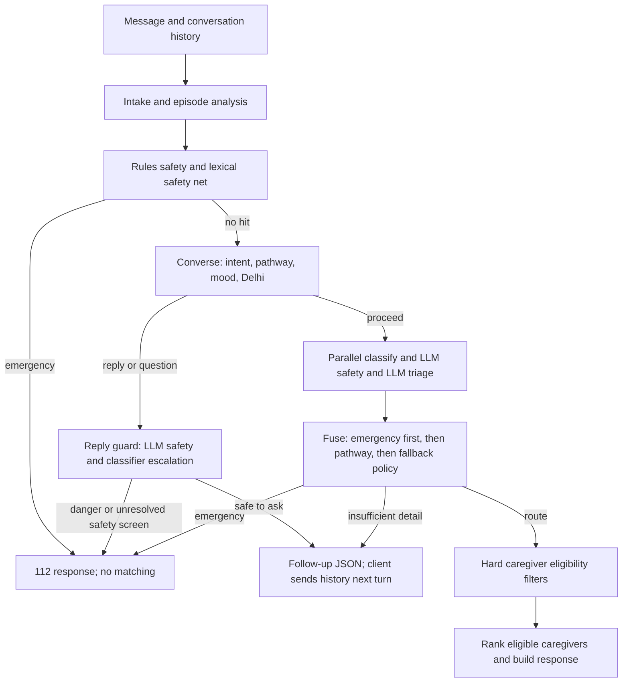

<a id="readme-top"></a>

<!-- PROJECT SHIELDS -->
<div align="center">

[![Issues][issues-shield]][issues-url]
[![MIT License][license-shield]][license-url]
[![Tests][tests-shield]][tests-url]
[![Emergency recall][recall-shield]][eval-url]

</div>

<!-- PROJECT LOGO -->
<br />
<div align="center">
  <a href="https://github.com/dipesh4000/CareCompass-HackIIITD">
    
  </a>

  <h3 align="center">CareCompass</h3>

  <p align="center">
    Describe a health need in English, Hindi or Hinglish. Get the right kind of care, how urgent it is, and a caregiver who can actually come.
    <br />
    Built for <b>HACK IIITD</b> (CAI, IIIT-Delhi)
    <br />
    <br />
    <a href="backend/README.md"><strong>Explore the docs »</strong></a>
    ·
    <a href="https://github.com/dipesh4000/CareCompass-HackIIITD/issues/new?labels=bug">Report Bug</a>
    ·
    <a href="https://github.com/dipesh4000/CareCompass-HackIIITD/issues/new?labels=enhancement">Request Feature</a>
  </p>
</div>

<!-- TABLE OF CONTENTS -->
<details>
  <summary>Table of Contents</summary>
  <ol>
    <li>
      <a href="#about-the-project">About The Project</a>
      <ul>
        <li><a href="#built-with">Built With</a></li>
        <li><a href="#how-it-works">How It Works</a></li>
      </ul>
    </li>
    <li>
      <a href="#getting-started">Getting Started</a>
      <ul>
        <li><a href="#prerequisites">Prerequisites</a></li>
        <li><a href="#installation">Installation</a></li>
      </ul>
    </li>
    <li><a href="#usage">Usage</a></li>
    <li><a href="#deployment">Deployment</a></li>
    <li><a href="#caregiver-scoring">Caregiver Scoring</a></li>
    <li><a href="#fine-tuning-results-and-what-shipped">Fine-tuning Results and What Shipped</a></li>
    <li><a href="#mapping-the-shared-workflow-to-the-current-code">Shared Workflow vs Current Code</a></li>
    <li><a href="#how-decisions-and-exclusions-are-reached">Decisions and Exclusions</a></li>
    <li><a href="#evaluation">Evaluation</a></li>
    <li><a href="#api">API</a></li>
    <li><a href="#roadmap">Roadmap</a></li>
    <li><a href="#contributing">Contributing</a></li>
    <li><a href="#license">License</a></li>
    <li><a href="#acknowledgments">Acknowledgments</a></li>
  </ol>
</details>

<!-- ABOUT THE PROJECT -->
## About The Project

<p align="center">
  
  <br />
  <sub>One clear question when the message is vague.</sub>
</p>

A family types something like *"mummy theek nahi hai, kal raat se bukhar hai"*. CareCompass:

1. **Checks for emergencies first.** Chest pain, trouble breathing, collapse, heavy bleeding and similar red flags go straight to **112**. No home visit, no caregivers.
2. **Asks one question at a time.** Recognised symptom pathways use up to four fixed questions; a vague service request uses the fallback dialogue.
3. **Picks the care type and urgency**: paramedic home visit, home nursing, lab test at home, teleconsultation or 112.
4. **Matches caregivers** who speak the family's language, live nearby, are free and have the right skill.
5. **Explains every decision** in plain words.

**Safety contract**

- Deterministic rules run **first** and cannot be overridden.
- Any source (rules, your model, Gemini) can escalate to 112. **None can de-escalate.**
- A *possible* red flag triggers a non-repeated safety question while budget remains; otherwise it escalates. Pathways have a four-question cap; fallback routing defaults to two questions, with an optional timing question. Anger reduces the question budget to one.
- Invalid or unavailable LLM output is discarded; deterministic safety and pathway decisions remain available. Provider chains can try another configured provider.

<p align="right">(<a href="#readme-top">back to top</a>)</p>

### Built With

[![React][react-shield]][react-url]
[![Vite][vite-shield]][vite-url]
[![TypeScript][ts-shield]][ts-url]
[![FastAPI][fastapi-shield]][fastapi-url]
[![LangGraph][langgraph-shield]][langgraph-url]
[![Pydantic][pydantic-shield]][pydantic-url]
[![Gemini][gemini-shield]][gemini-url]
[![uv][uv-shield]][uv-url]

<p align="right">(<a href="#readme-top">back to top</a>)</p>

### How It Works

**Implementation snapshot: 25 October 2026. Production must run without local model weights.** Rules, lexicons, JSON pathways and caregiver tables run locally on CPU. Optional hosted LLMs provide intent fallback, safety screening and the older non-pathway triage branch. No fine-tuned encoder was promoted into production. A hosted LLM still uses a model at its provider; “no runtime weights” here means CareCompass does not load or serve local encoder/checkpoint weights.



The parallel `llm_triage` node returns immediately when a pathway is active; its assessment cannot replace a pathway disposition. Question turns still run `reply_guard`. Rules emergencies terminate before any LLM call. The graph has **13 registered nodes**, including the conversation and reply-guard nodes omitted from the earlier diagram. See [builder.py](backend/app/graph/builder.py) and [nodes.py](backend/app/graph/nodes.py).

| Component | What actually runs | Evidence |
|---|---|---|
| Intake | Normalisation, language selection, tri-state concepts, current conversation episode, count of real questions | [intake.py](backend/app/services/intake.py), [dialogue.py](backend/app/services/dialogue.py) |
| Health recognition | Curated condition aliases, fuzzy Latin spelling, medical morphology/context and generated symptom vocabulary; optional LLM may widen `general` to `health` only at medium/high confidence | [conditions.py](backend/app/services/conditions.py), [intent_llm.py](backend/app/services/intent_llm.py) |
| Safety floor | Nine official red-flag categories, explicit emergency requests and optional lexical exemplar similarity | [safety.py](backend/app/services/safety.py), [redflags.json](backend/app/rules/redflags.json), [semantic_safety.py](backend/app/services/semantic_safety.py) |
| Pathways | Seven JSON question trees; fixed answer-to-disposition rules, age/pregnancy adjustments, review status | [pathways.py](backend/app/services/pathways.py), [pathways.json](backend/app/rules/pathways.json) |
| Mood | Regex cues over the scoped user episode: panic, anger, anxiety, neutral; fixed tone text and caution flags | [mood.py](backend/app/services/mood.py), `Nodes.converse` / `_mood_text` |
| Delhi | 18 areas, alias/coordinate resolution, seasonal emphasis of existing questions | [delhi.py](backend/app/services/delhi.py), [delhi.json](backend/app/rules/delhi.json) |
| Non-pathway routing | RuleRouter proposes service; optional validated LLM assessment is combined under `FUSION_POLICY` | [routing.py](backend/app/services/routing.py), `Nodes.fuse` |
| Matching | Required-role/skill/radius/availability filters, weighted ranking and top-three selection | [matching.py](backend/app/services/matching.py) |
| Output | Closed response schema; a question cannot carry a care decision/caregivers; an emergency cannot carry caregivers; red flags require emergency | [external.py](backend/app/schemas/external.py) |

#### Production configuration without local weights

Set these **process/deployment environment variables before starting the backend**:

```dotenv
ROUTER_BACKEND=rules
SEMANTIC_EMBEDDER=ngram
INTENT_ENCODER_PATH=
ENCODER_PATH=
```

`rules` is the code default, but an existing environment or private `.env` can override it. The three independent optional weight-loading paths are the trained router (`ROUTER_BACKEND=trained`), semantic intent (`INTENT_ENCODER_PATH`), and e5 semantic safety (`SEMANTIC_EMBEDDER=e5`). Disable all three as above. The `.env` loader preserves process variables. No checkpoint, ONNX encoder, Torch or GPU is needed for production. `LLM_BACKEND=off` additionally disables hosted LLM calls; it is separate from the no-local-weights rule. `/health` shows the selected classifier and provider configuration, but is not a complete audit of all three encoder paths.

The n-gram safety net computes character 3–5-gram TF-IDF representations from the checked-in exemplar text at startup; it does not load learned encoder weights. Its default cosine threshold is 0.42 with a positive-vs-benign margin of 0.07, subject to lexical anchors and negation checks. These are heuristic draft thresholds, not clinical probabilities.

### Fine-tuning Results and What Shipped

**The GPU work is finished. It improved an offline disease-naming task, but did not produce a better care-routing model.** The deterministic pathway integration happened afterwards; its gains in behaviour must not be attributed to fine-tuning.

The CPU reference fitted logistic-regression heads on frozen multilingual-e5 embeddings: care-type head `C=0.3`, class balanced; separate binary emergency head `C=0.03` on standardised embeddings. The saved [router_e5_lr.json](backend/app/models/router_e5_lr.json) belongs to the optional experimental encoder route. The encoder and its head are not required by the production pathway route.

The GPU comparison used **66 unique CareCompass texts in 20 scenario families**, evaluated by leave-one-family-out (LOFO). Stage A adapted e5, MuRIL and XLM-R to name 10 diseases from 1,779 multilingual complaints, with 197 held out. Stage B compared the base/adapted encoders, frozen features vs full fine-tuning, on CareCompass. Stage A used 2 epochs, learning rate 2e-5, batch 32; Stage B used 12 epochs, learning rate 3e-5, batch 16, emergency class weight ×3 and three fine-tuning seeds. These were fixed recipes, not a hyperparameter search.

| Encoder / variant | Care-type macro-F1 | Emergency recall | Non-emergencies sent to emergency, out of 57 |
|---|---:|---:|---:|
| e5 base, frozen + LR | 0.641 | 0.667 | 5.0 |
| e5 adapted, frozen + LR | 0.632 | 0.444 | 4.0 |
| e5 base, fine-tuned | 0.603 | 0.778 | 5.667 |
| e5 adapted, fine-tuned | 0.518 | 0.630 | 5.667 |
| MuRIL base, frozen | 0.551 | 0.778 | 3.0 |
| MuRIL adapted, frozen | 0.402 | 0.778 | 7.0 |
| MuRIL base, fine-tuned | 0.056 | 1.000 | 52.333 |
| MuRIL adapted, fine-tuned | 0.219 | 1.000 | 24.333 |
| XLM-R base, frozen | 0.511 | 0.556 | 6.0 |
| XLM-R adapted, frozen | 0.359 | 0.333 | 3.0 |
| XLM-R base, fine-tuned | 0.318 | 1.000 | 17.0 |
| XLM-R adapted, fine-tuned | 0.529 | 1.000 | 3.667 |

Source: [GPU multilingual report](pipeline/reports/10_gpu_multilingual.md). Fractional false-alarm counts are means across seeds. Stage A held-out disease accuracy was **1.000 / 0.954 / 0.944** for e5 / MuRIL / XLM-R. Disease recognition did not transfer reliably to service choice or urgency. The report's MuRIL/XLM-R `ADOPT` entries compare adaptation only with each model's weaker fine-tuned baseline; they do not beat frozen e5 overall and are not deployment approvals. MuRIL's perfect emergency recall largely came from calling almost everything an emergency.

The earlier CPU e5 reference scored **0.680 macro-F1**, with emergency recall **0.667**; its care-type `C` was selected using the same folds, so that estimate is optimistic. It is a different experiment from the GPU recipe's 0.641. Neither model-only recall is the graph's 21/21 gold emergency recall. There are only nine emergency training examples in three families; uncertainty is substantial. See [progress.md](progress.md) and [the frozen-encoder report](pipeline/reports/08_embed_router.md).

| What changed | What is used now |
|---|---|
| External-data audit | Urgency accuracy 0.348 vs majority 0.366; urgency/severity labels are excluded from routing/emergency training. Disease labels were used only for the offline adaptation experiment. |
| Multilingual asset extraction | 232 symptom-cue tokens were saved to `dataset_vocab.json`; runtime intent uses its non-English/non-Hinglish entries and requires at least two matching cues. This is data-derived recognition, not a fine-tuned model prediction. |
| Lexical distillation | Student macro-F1 about 0.35–0.36 failed to reproduce e5's routing; no distilled routing-weight model was adopted. |
| Optional encoder integration | Historical `trained` mode is connected, with emergency ask/escalate thresholds 0.15/0.65 and ambiguity log-margin 0.0181. It is excluded from the no-weights production configuration. The artifact's old 0.10 emergency cutoff is not the current policy. |
| Current production behaviour | Seven deterministic pathways, history replay, uncertainty handling, patient strictness, mood and Delhi lookup are connected. Their decisions come from authored JSON/rules, not from GPU weights. |

Dataset provenance: [multilingual audit](pipeline/reports/09_multilingual_dataset.md), [pathway generator](pipeline/scripts/build_pathways.py), [Delhi asset generator](pipeline/scripts/build_delhi_assets.py). CareCompass-labelled examples supply the offline service/urgency benchmark; SYNAPSE supplies symptom vocabulary; caregivers.csv supplies the roster and Delhi areas. DDXPlus evidence-based question ordering, further translated terms and MediQ-driven dialogue changes remain pending. Raw training datasets and `pipeline/models_ft/` are not read by the production request graph.

### Mapping the Shared Workflow to the Current Code

Reference: [CareCompass Request Flow artifact](https://claude.ai/artifact/Qh8QXL78dhXzV96FMtr9FV), a **24 October 2026 historical snapshot**, compared with the local code on 25 October. It describes the earlier architecture; the table below records what is retained and what supersedes it.

| Artifact item | Current implementation / status |
|---|---|
| Safety before models | Retained: rules emergencies terminate immediately; no provider or matching call follows. |
| Parallel decisions and fusion | Retained for proceeding requests. Conversation/question branches now run first; pathway triage assessment is skipped. |
| Classifier not connected | Superseded: optional e5 mode is connected; production deliberately selects rules. |
| Emergency cutoff 0.10 | Superseded: optional encoder uses ask 0.15 / escalate 0.65; absent from production. |
| Fine-tuning pending | Completed; no GPU candidate adopted. Results and limitations are above. |
| Ten-node graph | Expanded to 13 registered nodes with conversation/reply handling. |
| Two Gemini 2.5 calls | Superseded: calls depend on branch, provider chains and retries; model names are configurable. |
| Thirteen seed caregivers | Superseded default: 60-row `caregivers.csv`; the 13-row seed remains for tests. |
| Two runtime files | Superseded: pathways, Delhi, safety exemplars and vocabulary assets also participate. |
| Two-question limit | Fallback default remains two; pathway cap is four; anger caps questions at one. |
| Stateless API / endpoint aliases | Retained; the client sends history every turn. Age/pregnancy are now typed optional context. |
| Every decision explained | Rule explanations and traces exist; full rejected-candidate and answer-level provenance are not yet exposed. |

Provider details: [llm_router.py](backend/app/services/llm_router.py) supports Gemini, a second Gemini credential, Groq and a configured OpenAI-compatible endpoint, with independent safety/triage chains. Configured defaults include `gemini-3.5-flash` and `llama-3.3-70b-versatile`; actual deployed models depend on environment. A rules emergency makes zero LLM calls; a normal pathway question or disposition uses a safety screen when enabled; a non-pathway route may use both safety and triage; the general-to-health fallback may add an intent call. Retries/provider fallback can add HTTP requests. User message/history is transmitted to whichever provider is configured for those calls. The application's voice service can separately call Sarvam. Thus “only outbound call” and “exactly two calls” are not current guarantees.

### How Decisions and Exclusions Are Reached

“Exclusion” has three distinct meanings here: rejecting an unsafe **care route**, dropping an ineligible **caregiver**, and declining to infer a **medical conclusion** from insufficient information. CareCompass does not perform differential diagnosis and does not medically rule out diseases.

#### 1. Intake and safety: what may stop a normal route

The request accepts 1–2,000 input characters, up to 40 history turns, validated latitude/longitude, a supported language and optional `patient_context: {age_years, pregnant}`. Age must be finite and between 0 and 130; invalid typed input returns 422. Unknown request fields and legacy briefcase member records are ignored.

The dialogue layer extracts concepts from the current episode: later statements overlay earlier ones, a new topic can reset the episode, and recognised pathway question texts identify subsequent replies as answers. Safety separately scans **all user turns supplied in history plus the latest input**. Consequently an old dangerous statement can still trigger an emergency even after the routing episode changes. Only user text, not the assistant's own list of danger signs, feeds that safety scan.

The nine API flag values remain `chest_pain`, `breathlessness`, `unconsciousness`, `severe_bleeding`, `stroke_symptoms`, `seizure`, `high_fever_infant`, `suicidal_ideation`, `severe_dehydration`. A regex/all-of rule hit, an explicit emergency/ambulance request, or an accepted lexical safety hit sends the case to 112 before normal routing. Immediate negation can suppress applicable matches; `negation_safe` rules deliberately bypass that suppression. This is bounded pattern logic, not complete understanding of time, context or negation.

A “yes” to the generic danger screen also triggers emergency. Later, classifier emergency output, a present LLM red flag, an LLM emergency care/urgency assessment on the fallback branch, or a pathway emergency can escalate. A possible LLM flag is never silently treated as absent: ask its screening question only if supplied, not already asked and within the branch's budget; otherwise send to 112. Once on the emergency path, **all home/lab/teleconsultation recommendations and caregiver matching are excluded**. Some emergency sources legitimately have `red_flags: []` because no official flag was identified; no new enum is invented.

A negative screen means only that the matching rule did not fire or the specified symptom was denied. It does **not** establish that an illness is absent or that the person is safe.

#### 2. Pathway selection, questions and stopping rules

`pathways.select` counts distinct matching cue regexes per pathway, chooses the greatest count, and breaks ties by JSON order. It has no probability, learned risk score or diagnosis. `conversation_step` is eligible only for `health`/`answer` turns without an explicit nursing/lab/consult service request. A service request skips the symptom pathway, but still passes the safety layers.

Every request replays the scoped history. The exact English/Hindi/Hinglish question text maps to `pathway:<id>:<question_id>`. `parse_answer` accepts a matching option label in any supported language, recognised yes/no wording, or recognised uncertainty where that question has an `unsure` option. Unrecognised text remains unanswered; a question can repeat while clarification is needed. Arbitrary LLM paraphrasing of these question texts is **not** wired: preserving the registered text is necessary for replay today.

`evaluate` scans rules in file order and uses the **first matching rule**. All conditions in a rule must match. Emergency/urgent rules may finish early; routine/self-care rules wait until every question has an answer. If all questions are resolved and nothing matches, the default is same-day teleconsultation. Before the next question, the conversation cap is checked: four questions normally, one for anger. At the cap, unresolved questions become `unsure` and are evaluated conservatively; the implementation currently does not extend beyond four even when the user cannot answer. Not every non-danger uncertainty means emergency: the specific JSON rule decides it.

The following is the complete current pathway inventory. Question text, options, explanations and advice in all three languages are in [pathways.json](backend/app/rules/pathways.json). **All content is UNREVIEWED demo logic; the table describes software behaviour, not validated clinical guidance.**

**`fever`** — questions in order:

- `danger`: Is there trouble breathing, confusion or unusual sleepiness, a stiff neck, a seizure, bluish lips, or a rash that does not fade when pressed? Options: `yes` = Yes; `no` = No; `unsure` = Not sure. Danger question.
- `bleed`: Any bleeding (gums, nose, black stool), severe belly pain, or repeated vomiting? Options: `yes` = Yes; `no` = No; `unsure` = Not sure.
- `duration`: How many days has the fever lasted? Options: `short` = Less than 2 days; `mid` = 2 to 4 days; `long` = 5 days or more.
- `fluids`: Is the person drinking fluids and passing urine normally? Options: `yes` = Yes; `no` = No; `unsure` = Not sure.

| Rule (first match wins) | Answer condition | Internal disposition | API care type | API urgency |
|---|---|---|---|---|
| `fever#0` | `danger` ∈ {yes, unsure} | `emergency` | `emergency_112` | `emergency` |
| `fever#1` | `bleed` ∈ {yes, unsure} | `urgent` | `paramedic_home_visit` | `same_day` |
| `fever#2` | `fluids` ∈ {no} | `urgent` | `paramedic_home_visit` | `same_day` |
| `fever#3` | `duration` ∈ {long} | `urgent` | `teleconsultation` | `same_day` |
| `fever#4` | `duration` ∈ {mid} | `routine` | `teleconsultation` | `scheduled` |
| `fever#5` | `duration` ∈ {short} | `self_care` | `teleconsultation` | `scheduled` |

**`cough_breathing`** — questions in order:

- `danger`: Is the person struggling to breathe, unable to speak a full sentence, with blue lips, or chest pain? Options: `yes` = Yes; `no` = No; `unsure` = Not sure. Danger question.
- `blood`: Coughing up blood, or a known lung/heart condition getting worse? Options: `yes` = Yes; `no` = No; `unsure` = Not sure.
- `duration`: How long has the cough lasted? Options: `short` = Under a week; `mid` = 1 to 3 weeks; `long` = More than 3 weeks.

| Rule (first match wins) | Answer condition | Internal disposition | API care type | API urgency |
|---|---|---|---|---|
| `cough_breathing#0` | `danger` ∈ {yes, unsure} | `emergency` | `emergency_112` | `emergency` |
| `cough_breathing#1` | `blood` ∈ {yes, unsure} | `urgent` | `paramedic_home_visit` | `same_day` |
| `cough_breathing#2` | `duration` ∈ {long} | `routine` | `teleconsultation` | `scheduled` |
| `cough_breathing#3` | `duration` ∈ {mid} | `routine` | `teleconsultation` | `scheduled` |
| `cough_breathing#4` | `duration` ∈ {short} | `self_care` | `teleconsultation` | `scheduled` |

**`vomit_diarrhoea`** — questions in order:

- `danger`: Is there blood in vomit or stool (or black stool), severe constant belly pain, or is the person very drowsy or hard to wake? Options: `yes` = Yes; `no` = No; `unsure` = Not sure. Danger question.
- `dehydration`: Very dry mouth, no urine for 8 hours, sunken eyes, or dizziness on standing? Options: `yes` = Yes; `no` = No; `unsure` = Not sure.
- `duration`: For how long? Options: `short` = Under 2 days; `long` = 2 days or more.

| Rule (first match wins) | Answer condition | Internal disposition | API care type | API urgency |
|---|---|---|---|---|
| `vomit_diarrhoea#0` | `danger` ∈ {yes, unsure} | `emergency` | `emergency_112` | `emergency` |
| `vomit_diarrhoea#1` | `dehydration` ∈ {yes, unsure} | `urgent` | `paramedic_home_visit` | `same_day` |
| `vomit_diarrhoea#2` | `duration` ∈ {long} | `routine` | `teleconsultation` | `scheduled` |
| `vomit_diarrhoea#3` | `duration` ∈ {short} | `self_care` | `teleconsultation` | `scheduled` |

**`chest_pain`** — questions in order:

- `now`: Is the pain present now, or did it happen in the last hour? Options: `yes` = Yes; `no` = No; `unsure` = Not sure. Danger question.
- `spread`: Does it spread to the arm, jaw or back, or come with sweating, breathlessness or nausea? Options: `yes` = Yes; `no` = No; `unsure` = Not sure. Danger question.
- `risk`: Known heart disease, diabetes or high BP, or age 40 or above? Options: `yes` = Yes; `no` = No; `unsure` = Not sure.

| Rule (first match wins) | Answer condition | Internal disposition | API care type | API urgency |
|---|---|---|---|---|
| `chest_pain#0` | `now` ∈ {yes, unsure} | `emergency` | `emergency_112` | `emergency` |
| `chest_pain#1` | `spread` ∈ {yes, unsure} | `emergency` | `emergency_112` | `emergency` |
| `chest_pain#2` | `risk` ∈ {yes, unsure} | `urgent` | `teleconsultation` | `same_day` |
| `chest_pain#3` | `risk` ∈ {no} | `routine` | `teleconsultation` | `scheduled` |

**`injury_wound`** — questions in order:

- `danger`: Heavy bleeding that does not stop after 10 minutes of firm pressure, a bone showing, a head injury with vomiting or drowsiness, or a very large burn? Options: `yes` = Yes; `no` = No; `unsure` = Not sure. Danger question.
- `deep`: Is the wound deep, gaping, dirty, or an animal bite? Options: `yes` = Yes; `no` = No; `unsure` = Not sure.
- `tetanus`: Tetanus shot in the last 5 years? Options: `yes` = Yes; `no` = No; `unsure` = Not sure.

| Rule (first match wins) | Answer condition | Internal disposition | API care type | API urgency |
|---|---|---|---|---|
| `injury_wound#0` | `danger` ∈ {yes, unsure} | `emergency` | `emergency_112` | `emergency` |
| `injury_wound#1` | `deep` ∈ {yes, unsure} | `urgent` | `home_nursing` | `same_day` |
| `injury_wound#2` | `tetanus` ∈ {no, unsure} | `routine` | `teleconsultation` | `scheduled` |
| `injury_wound#3` | `tetanus` ∈ {yes} | `self_care` | `home_nursing` | `scheduled` |

**`diabetes_bp`** — questions in order:

- `danger`: Confusion, fainting, fruity-smelling breath, or with high BP: severe headache, chest pain, or weakness on one side? Options: `yes` = Yes; `no` = No; `unsure` = Not sure. Danger question.
- `reading`: Is today's reading very high (sugar above 300 mg/dL or BP 180/110 or more) or very low (sugar below 70)? Options: `yes` = Yes; `no` = No; `unsure` = Not sure.
- `need`: What do you need? Options: `test` = A routine check or lab test; `doctor` = Medicine review with a doctor; `other` = Something else.

| Rule (first match wins) | Answer condition | Internal disposition | API care type | API urgency |
|---|---|---|---|---|
| `diabetes_bp#0` | `danger` ∈ {yes, unsure} | `emergency` | `emergency_112` | `emergency` |
| `diabetes_bp#1` | `reading` ∈ {yes, unsure} | `urgent` | `teleconsultation` | `same_day` |
| `diabetes_bp#2` | `need` ∈ {test} | `routine` | `lab_test_home` | `scheduled` |
| `diabetes_bp#3` | `need` ∈ {doctor, other} | `routine` | `teleconsultation` | `scheduled` |

**`elderly_weakness`** — questions in order:

- `danger`: Sudden weakness on one side, slurred speech, drooping face, fainting, or a fall with injury? Options: `yes` = Yes; `no` = No; `unsure` = Not sure. Danger question.
- `intake`: Is the person eating, drinking and passing urine normally? Options: `yes` = Yes; `no` = No; `unsure` = Not sure.
- `duration`: How long has this been going on? Options: `short` = Today or yesterday; `mid` = A few days; `long` = Weeks.

| Rule (first match wins) | Answer condition | Internal disposition | API care type | API urgency |
|---|---|---|---|---|
| `elderly_weakness#0` | `danger` ∈ {yes, unsure} | `emergency` | `emergency_112` | `emergency` |
| `elderly_weakness#1` | `intake` ∈ {no} | `urgent` | `paramedic_home_visit` | `same_day` |
| `elderly_weakness#2` | `duration` ∈ {mid, long} | `routine` | `paramedic_home_visit` | `scheduled` |
| `elderly_weakness#3` | `duration` ∈ {short} | `self_care` | `paramedic_home_visit` | `scheduled` |

The chest-pain pathway does not override the earlier safety engine: a safety match for chest pain can already have ended the request at 112 before these questions are reached. Similarly, an early lexical false alarm cannot be de-escalated by later pathway answers.

#### 3. Patient context, mood and locality adjustments

| Input / condition | Exact effect and limit |
|---|---|
| Infant: age < 1 | `self_care` or `routine` → `urgent`. If that raises a teleconsultation to urgent, the service becomes `paramedic_home_visit`. |
| Child: 1 ≤ age < 5 | `self_care` → `routine`; no self-care advice retained. |
| Elder: age ≥ 65 | `self_care` → `routine`; no self-care advice retained. |
| Pregnant | `self_care` or `routine` → `urgent`; teleconsultation normally stays teleconsultation. |
| Missing context | No age/pregnancy adjustment is inferred from the briefcase. The frontend's current triage payload does not send `patient_context`; API callers must supply it for these checks. |
| Panic | Danger first; an uncertain/unrecognised generic danger answer escalates. Pathway danger uncertainty follows its JSON rule. Calm short tone; no reduction in urgency. |
| Anger | One question maximum; remaining pathway uncertainty is evaluated, and response text offers requesting a human call-back. It does not schedule or notify a person. |
| Anxiety | Supportive fixed wording; no change to the pathway disposition. |
| Coordinates | Take precedence over aliases; nearest area is resolved only within its declared radius. Actual coordinates remain the matching location. |
| Area name only | Longest matching alias wins only if unambiguous; its area centre approximates the matching location. Ambiguous `gurgaon`/`noida` aliases do not invent a location. |
| No resolved locality / coordinates | Matching can proceed with proximity omitted; absence of location is not proof of coverage. |
| Season | For a resolved service area, month-specific notes emphasise the existing fever `bleed` or respiratory `danger` question. They do not change question order or disposition. Other seasonal topics in the asset are not yet used. |

These context requirements apply to pathway strictness; the safety rules can separately recognise danger wording such as infant fever in the message. Age-group adjustment runs before pregnancy adjustment. Any strictness increase removes self-care advice. Mood is detected across the scoped user episode, so an earlier panic/anger cue can persist while that episode continues. Mood text and seasonal notes currently include fixed English additions even alongside a Hindi/Hinglish question; full localisation of those additions remains open.

Internal disposition mapping is `emergency → emergency`, `urgent → same_day`, `routine → scheduled`, `self_care → scheduled`. A self-care result keeps a bookable care type; advice appears in `reasoning`, not a new care type or urgency. Advice is copied from the existing draft asset; no dosage calculation or diagnosis is performed. Public-source families are named in the [generator header](pipeline/scripts/build_pathways.py), but per-rule clinical citations and clinician approval remain incomplete.

#### 4. If no pathway applies: how other care types are selected

After the safety guards, `RuleRouter` checks the following order. The numbers are authored confidence constants, **not calibrated probabilities**:

| First satisfied rule | Proposed service | Confidence |
|---|---|---:|
| A nursing/procedure concept | `home_nursing` | 0.90 |
| Consultation plus report review | `teleconsultation` | 0.85 |
| Lab concept | `lab_test_home` | 0.85 |
| Consultation without a home-visit request | `teleconsultation` | 0.80 |
| Symptom, or consultation plus home request | `paramedic_home_visit` | 0.75 with home request; otherwise 0.65 |
| Named condition without the above | `teleconsultation` | 0.60 |
| None | No proposed service; ask or fallback | 0.00 |

The retained fallback branch can still take a validated LLM service/urgency proposal. `llm_first` defaults to that proposal; if an assessment exists but gives no care type it asks/falls back rather than automatically taking the rule proposal. `model_first` prefers a rule/classifier proposal at confidence ≥0.85, then the LLM, then an available lower-confidence classifier proposal. `agree_or_ask` asks on disagreement while budget remains, otherwise prefers an available LLM proposal. With no decision and budget exhausted, the default is `paramedic_home_visit`. Non-LLM fallback urgency is `same_day` for paramedic/nursing/teleconsultation and `scheduled` for lab collection. This branch is **not yet a purely deterministic disposition layer when hosted triage is enabled**; the pathway branch is deterministic. The LLM is also not currently used just to reword a pathway result.

Greeting, general, refusal, stop and frustration turns can return a conversational response without selecting a service, but safety still runs. The default fallback question budget is two; optional visit-timing questioning can add one. Timing stated by the user wins; otherwise strong severity words imply `now`, else `today`. Timing changes caregiver availability selection, not the care type/urgency enum. A booking or disease conclusion is not inferred from a general reply.

#### 5. Worked route, uncertainty and emergency examples

- **Direct emergency:** a recognised current chest-pain statement fires safety → 112 → empty caregiver list. No pathway completion, LLM assessment or ranking is needed.
- **Fever, no warning answers, adult age 30:** `danger=no`, `bleed=no`, `duration=short`, `fluids=yes` → `fever#5` → internal `self_care` → `teleconsultation / scheduled`, with the asset's advice. All four answers are needed before this low-caution rule can finish.
- **Same answers, pregnant:** `fever#5` initially matches, then pregnancy strictness raises it to `urgent` → `teleconsultation / same_day`; self-care advice is removed. Age 0.5 instead raises it to a same-day paramedic visit.
- **Uncertain danger:** `danger=unsure` → `fever#0` → 112. This is precaution, not a positive diagnosis. `bleed=unsure` after `danger=no` instead matches `fever#1` → same-day paramedic care.
- **Routine service request:** a recognised prescribed injection request selects nursing through the fallback service flow, subject to safety/provider fusion; only eligible medics with the required skill can then be ranked.
- **No eligible caregiver:** retain the selected care type and urgency, return an empty list and a no-match explanation. Do not substitute an unqualified caregiver or reduce urgency.

#### 6. What the explanation and trace prove

`POST /triage/trace` (also `/api/v1/triage/trace`) returns the response, final decision, component metadata and node traces. Safety trace records fired rule IDs/flags; conversation trace records intent, question count, mood and resolved area; pathway fusion records pathway ID, rule ID and strictness increase; matching trace records eligible count, required skills and the returned candidates' component scores.

It does **not** return a complete excluded-candidate ledger, every rejected clinical alternative, or a structured record of every pathway answer. A follow-up has no final route to explain. Displayed `reasoning` is the pathway's fixed `why`/advice, a fallback template or validated LLM wording depending on branch. `response_source=gemini` is a legacy label for an available triage assessment, not a guarantee that Gemini personally served the request; safety-only hosted calls may still produce `response_source=rules`. Use the actual provider configuration and node trace to interpret it.

A complete audit trail would need structured answer/evidence records, reasons for every caregiver exclusion, fully localised text and reviewed clinical citations. Those are remaining work, not capabilities claimed here.


<!-- GETTING STARTED -->
## Getting Started

### Prerequisites

* [uv](https://docs.astral.sh/uv/) for the backend
  ```sh
  # macOS / Linux
  curl -LsSf https://astral.sh/uv/install.sh | sh
  # Windows (PowerShell)
  powershell -c "irm https://astral.sh/uv/install.ps1 | iex"
  ```
* Node.js 24 LTS for the frontend

### Installation


On Windows, double-click [`start.cmd`](start.cmd) (or run `.\start.cmd` in PowerShell) to start both servers. Install the prerequisites above first. The launcher syncs backend dependencies, installs frontend dependencies when `node_modules` is missing, and opens the app at http://127.0.0.1:5173. It connects the frontend to the local backend, with offline demo mode disabled. Press **Ctrl+C** in each server window to stop, then close the windows.

To start each server manually:

```sh
cd backend
uv sync --locked
# Copy .env.example to .env and configure server-side provider keys.
uv run uvicorn app.main:app --reload --host 127.0.0.1 --port 8000
```

In a separate terminal:

```sh
cd frontend
npm ci
npm run dev
```

Open http://127.0.0.1:5173. On Windows, use `npm.cmd` if PowerShell blocks `npm.ps1`.

<p align="right">(<a href="#readme-top">back to top</a>)</p>

### Sarvam voice

**To activate Sarvam locally:** copy `frontend/.env.example` to `frontend/.env.local`, add `SARVAM_API_KEY`, restart the frontend, and reload. Local environment files are ignored.

For a fresh clone, copy `frontend/.env.example` to `frontend/.env.local` first. See [voice setup](frontend/VOICE.md) for local and Vercel configuration. The key stays server-side; no Python backend speech changes are required.

**Hands-free conversation:** open **Find care**, press the microphone (**Start voice conversation**) and allow microphone access. Speak, then pause; the app transcribes and submits your turn, speaks the care backend's reply and listens again. A transcript and listening, transcribing, thinking and speaking states appear inside the chat composer, without a separate floating panel.

- **Done speaking** ends the current recording; **Speak now** interrupts a reply and starts listening.
- **Pause / Resume listening** controls capture. **End voice conversation**, Escape, navigation and hiding the tab end the session.
- Sarvam turns are limited to 25 seconds; about 1.25 seconds of quiet after speech submits a turn. Ten seconds without speech pauses capture.
- Emergency guidance ends the conversation loop. Booking confirmation and emergency calls remain manual actions.

The existing care backend supplies the answers; Sarvam provides speech recognition and speech synthesis. This is turn-based care conversation, with the microphone off during replies. Supported browsers provide speech fallback when Sarvam is not configured. Typed chat replies stay silent until **Read aloud** is selected; voice conversation mode speaks automatically.

The latest local deployment review passed the frontend build and **64 frontend tests**. That earlier review had **267 backend passes and 1 skip** with encoder tests excluded. The later pathway integration recorded **296 backend passes and 1 skip**, including fake-encoder tests with NumPy installed; these are separate snapshots. These counts are saved local review snapshots, not CI results. Live provider calls, phone installation and microphone behavior still need testing on the deployed domain. See the [frontend guide](frontend/README.md#voice-conversation) and [full voice setup](frontend/VOICE.md).


<!-- USAGE -->
## Usage

Type a request, answer follow-up questions, then pick a caregiver. Theme controls are available through **Settings** at the bottom of the sidebar.

<table>
  <tr>
    <td width="50%"></td>
    <td width="50%"></td>
  </tr>
  <tr>
    <td align="center"><sub><b>A recommendation with the reason behind it</b>, in the language the family wrote in.</sub></td>
    <td align="center"><sub><b>Caregivers ranked and explained</b>: language, distance, free slot and skills.</sub></td>
  </tr>
</table>

<p align="center">
  
  <br />
  <sub><b>Emergencies never reach a booking.</b> The red flags found are listed and matching is skipped.</sub>
</p>

The frontend walkthrough (Briefcase and health services) is in [`frontend/README.md`](frontend/README.md).

<p align="right">(<a href="#readme-top">back to top</a>)</p>

<!-- SCORING -->
## Deployment

- **One server:** follow [the deployment guide](docs/DEPLOYMENT.md) and use [`deploy/Caddyfile`](deploy/Caddyfile) for HTTPS, frontend deep links and API/voice routing.
- **Vercel Services:** use the repository root as the project Root Directory. [`vercel.json`](vercel.json) deploys the static `frontend`, Node `gateway`, and private Python `backend` together. The gateway care proxy uses the runtime `BACKEND_URL` binding; voice stays at `/api/voice`. Leave `VITE_API_BASE_URL` unset (or `/api`), set `VITE_DEMO_MODE=false`, and configure provider keys as server-only environment variables. `pipeline/` remains offline. See [Vercel Services setup](docs/DEPLOYMENT.md#vercel-services).
- **Phone shortcut/app:** on the HTTPS site, use Android's **Install app / Add to Home screen**, or Safari's **Share → Add to Home Screen**. The app includes a manifest and phone icons; care requests and voice require internet.

This remains a hackathon prototype: backend bookings are in memory, so use one Python worker and expect reservations to disappear on restart. Documents and frontend bookings clear on refresh; chats are saved only in the current browser. Public paid API access needs quotas/access controls. Model fine-tuning is complete; local model weights are excluded from production (see the configuration above).

## Caregiver Scoring

A clinical care type is selected **before** ranking. Scores cannot make an ineligible caregiver eligible or choose a different clinical disposition. Default data is the 60-row [caregivers.csv](backend/app/data/caregivers.csv); [caregivers_seed.csv](backend/app/data/caregivers_seed.csv) has 13 rows for tests. `CAREGIVERS_PATH` can override the roster.

### Hard exclusions, in execution order

| Check | Why a caregiver is excluded / exact exception |
|---|---|
| Active and right role | Inactive entries are removed. Paramedic visits and nursing require `medic`; lab collection requires `phlebotomist`; teleconsultation requires `doctor`. |
| Required skills | `required` is a list of alternative-skill sets. The caregiver must satisfy **every set**, with at least one skill from each set. A high rating or language match cannot compensate for failure. |
| Working window | Window must hold at least one 60-minute slot. Same-day availability must still fit today; scheduled eligibility permits a later day. |
| Unbooked slot | Same-day checks today's available slots; scheduled checks tomorrow's. Past dates and already booked slots are not returned by `slots_for`. This is a simple daily-window demo, not a full calendar integration. |
| Service radius | For non-teleconsultation with a known location, haversine distance must be ≤ that caregiver's own `max_radius_km`. Equality is allowed. Teleconsultation and unknown-location requests skip the geographic exclusion. |
| `now` preference | If any eligible caregiver is free now, other waiting candidates are removed; if none is free now, the soonest eligible candidates remain. |
| Top K | After ranking, only the first `top_k` (default 3) are returned. A fourth eligible caregiver is omitted because of list size, not because they failed a clinical/eligibility check. |

Required skills originate in extracted concepts and [REQUIRED_SKILLS](backend/app/services/lexicon.py), not in the rank score. Teleconsultation requires `teleconsultation`; lab collection adds an alternative group `{sample_collection, home_phlebotomy}` if absent. Home nursing/paramedic routes remove lab/consultation skill groups. Only a non-pathway decision whose basis is `llm` adds the LLM's extra required skills as singleton requirements. Thus pathway matching currently uses concept-derived skill requirements; it does not yet carry a separate per-pathway skill list.

Language is a **soft score**, not a hard exclusion: English requests score 1 for English, otherwise 0; Hindi/Hinglish score 1 for Hindi; Hinglish with only English scores 0.5; otherwise 0. A language mismatch can still appear if other candidates fail the hard filters. The default final list is not guaranteed to consist only of language-matching caregivers.

### Ranking among eligible caregivers

| Factor | Default weight | Component |
|---|---:|---|
| Language | 0.35 | Language score described above |
| Proximity | 0.30 | `max(0, 1 − distance / max(service_radius, 0.1))`; omitted when no distance is used |
| Skill | 0.20 | `0.85 × hint-skill coverage + 0.15 × tier` |
| Rating | 0.15 | `rating / 5`, clamped to [0, 1] |

Hint coverage is the proportion of hint skills present, or 1 with no hints. Medic tier scores are base 0.25, standard 0.5, advanced 0.75, expert 1.0; blank/unknown tier is 0.5. Non-medics use tier 1.0. Components and returned scores are rounded by the implementation. Final score is `sum(component × weight) / sum(included weights)`, so omitting proximity renormalises the other weights. For example, complete language/skill/rating components of 1 with no geographic component yield 1, not 0.70. Ties break by smaller wait, then caregiver ID.

A stated `later` timing uses scheduled availability even if the clinical urgency enum remains `same_day`; the UI therefore must not interpret an offered later slot as a medical downgrade. A locality centre is an approximation, and unknown location skips radius filtering; both affect what can be claimed about actual service coverage.

A candidate's displayed reason uses real profile fields: the strongest two available weighted factors plus availability. The trace includes returned candidates' components, but does not list each rejected caregiver and the failed check. Final booking rechecks the ID, active status and available slot, then atomically reserves it; it returns 404 for unavailable/unknown caregivers, 409 for unavailable/conflicting slots, and 422 for invalid request/date data. Bookings are in memory.

<!-- EVALUATION -->
## Evaluation

The current pathway snapshot is [task1_report.md](backend/eval/task1_report.md), generated against the unchanged **52-case** [gold_cases.jsonl](backend/eval/gold_cases.jsonl) with the LLM off and rules mode. It is separate from the 66-text/20-family offline LOFO experiment above. The older [report.md](backend/eval/report.md) records the pre-pathway result.

| Metric | Current pathway snapshot | Earlier saved snapshot |
|---|---:|---:|
| Emergency recall | **100% (21/21)** | 100% (21/21) |
| Correct red-flag named among caught emergencies | 100% (21/21) | See older report |
| False-alarm rate | 3.2% (1/31) | 3.2% |
| Care-type accuracy | **81.2% (39/48)** | 91.7% (44/48) |
| Care-type macro-F1 | 0.7800 | See older report |
| Urgency accuracy | 81.2% | See older report |
| Asked on vague input | 100% (4/4) | 4/4 |
| Extra question on an expected immediate-decision case | 16.7% (8/48) | See older report |
| Returned caregivers with required role/active, skills, free slot and radius | 100% for each check | See older report |
| Returned caregivers matching language | 79.2% | See older report |

The care-type score **fell after pathway integration**; this is not a fine-tuning improvement. Eight cases whose gold label expects an immediate service now receive a pathway safety question. A separate historical-chest-pain case remains a false emergency. The net is 39/48 correct service labels instead of 44/48; no emergency is missed. The gold data was not relabelled to conceal the changed behaviour. More realistic multi-turn evaluation is needed to assess whether the completed pathway reaches the right final service. The new API tests cover replay and convergence, but do not replace independent clinical evaluation.

Validation recorded for task 1: **296 tests passed, 1 skipped**, including fake-encoder wiring with NumPy installed. The real-encoder test was skipped; no weights or GPU were required. Existing fallback dialogue/fusion/encoder-simulation tests explicitly mock pathway selection to miss, so their assertions exercise that retained branch. [test_pathway_api.py](backend/tests/test_pathway_api.py) exercises actual selection, history, patient context, danger/unsure answers, mood, Delhi, seasonal emphasis and fresh rules-only startup.

To reproduce on PowerShell without local model weights or hosted calls:

```powershell
cd backend
$env:ROUTER_BACKEND = 'rules'
$env:SEMANTIC_EMBEDDER = 'ngram'
$env:INTENT_ENCODER_PATH = ''
$env:ENCODER_PATH = ''
$env:LLM_BACKEND = 'off'
$env:FAILURE_LOG = 'off'
$env:PYTHONIOENCODING = 'utf-8'
uv run --with numpy pytest -q
uv run python -m eval.run_eval --llm off --out eval/task1_report.md
```

NumPy is needed by fake-encoder tests, not by the rules/pathway deployment. `eval.run_eval` exits nonzero if gold emergency recall is below 1.0. The 21/21 figure is a regression result on these known cases, **not a guarantee of real-world emergency sensitivity**. The draft rules/pathways, self-care content and local emergency assets remain unreviewed; the dataset is small and team-authored. Clinical review and a larger independent set are pending.

<!-- API -->
## API

| Endpoint | Purpose |
|---|---|
| `POST /api/v1/triage` | Organiser contract: `{user_input, language, location?, conversation_history, patient_context?}` → care type, urgency, red flags, reasoning, matched caregivers |
| `POST /api/v1/triage/trace` | Same decision, plus a plain-words trace of every graph step |
| `GET /api/v1/caregivers?ids=CG_014&care_type=home_nursing` | Fetch matched profiles by required comma-separated IDs, with optional care type, date and location |
| `POST /api/v1/bookings` | Reserve an available caregiver/date/slot; conflicts return 409 |
| `GET /api/v1/graph` | The LangGraph flow as Mermaid |
| `GET /health` | Classifier, LLM, ruleset and fusion policy in use |

Config, fusion policy, prompts and schema enforcement are covered in [`backend/README.md`](backend/README.md).

<p align="right">(<a href="#readme-top">back to top</a>)</p>

<!-- ROADMAP -->
## Roadmap

- [x] Organiser-contract API with strict schemas
- [x] LangGraph pipeline with safety-first fusion and a Gemini fallback
- [x] Hindi / Hinglish red-flag rules and a 52-case evaluation set
- [x] Chat-style follow-up questions
- [x] Light and dark themes
- [x] Phone install manifest/icons and deployment configuration
- [x] Evaluate/connect the optional frozen-e5 classifier for offline comparison
- [x] Wire deterministic pathways, mood, Delhi aliases and stateless API tests
- [ ] Extend and clinically review pathway coverage; keep local weights out of production
- [ ] Verify the live Gemini path end to end
- [ ] Confirm red-flag rules and helpline numbers with clinicians or mentors
- [ ] A larger, independently written evaluation set
- [ ] Real caregiver and booking data

See the [open issues](https://github.com/dipesh4000/CareCompass-HackIIITD/issues) for the full list.

<p align="right">(<a href="#readme-top">back to top</a>)</p>

<!-- CONTRIBUTING -->
## Contributing

Contributions are welcome.

1. Fork the project
2. Create your feature branch (`git checkout -b feature/AmazingFeature`)
3. Commit your changes (`git commit -m 'Add some AmazingFeature'`)
4. Push to the branch (`git push origin feature/AmazingFeature`)
5. Open a pull request

Please run `uv run pytest -q` and `uv run python -m eval.run_eval` in `backend/` first. A change that makes the evaluation miss an emergency will not be merged.

<p align="right">(<a href="#readme-top">back to top</a>)</p>

<!-- LICENSE -->
## License

Distributed under the MIT License. See [`LICENSE`](LICENSE) for more information.

CareCompass is care navigation, not diagnosis or prescription. All caregivers and bookings are synthetic demo data. In a real emergency in India, call **112**.

<p align="right">(<a href="#readme-top">back to top</a>)</p>

<!-- ACKNOWLEDGMENTS -->
## Acknowledgments

* [HACK IIITD](https://www.iiitd.ac.in/) and the CAI team at IIIT-Delhi for the problem statement and baseline scoring recipe
* [Best-README-Template](https://github.com/othneildrew/Best-README-Template)
* [Shields.io](https://shields.io)
* [LangGraph](https://langchain-ai.github.io/langgraph/) and [FastAPI](https://fastapi.tiangolo.com/)

<p align="right">(<a href="#readme-top">Back to top</a>)</p>

<!-- MARKDOWN LINKS & IMAGES -->
[issues-shield]: https://img.shields.io/github/issues/dipesh4000/CareCompass-HackIIITD.svg?style=for-the-badge&color=0b6bb5
[issues-url]: https://github.com/dipesh4000/CareCompass-HackIIITD/issues
[license-shield]: https://img.shields.io/github/license/dipesh4000/CareCompass-HackIIITD.svg?style=for-the-badge&color=0b6bb5
[license-url]: LICENSE
[tests-shield]: https://img.shields.io/badge/tests-local_review-2e7d32?style=for-the-badge
[tests-url]: backend/tests
[recall-shield]: https://img.shields.io/badge/emergency_recall-100%25-2e7d32?style=for-the-badge
[eval-url]: backend/eval
[react-shield]: https://img.shields.io/badge/React_19-20232A?style=for-the-badge&logo=react&logoColor=61DAFB
[react-url]: https://react.dev/
[vite-shield]: https://img.shields.io/badge/Vite-646CFF?style=for-the-badge&logo=vite&logoColor=white
[vite-url]: https://vite.dev/
[ts-shield]: https://img.shields.io/badge/TypeScript-3178C6?style=for-the-badge&logo=typescript&logoColor=white
[ts-url]: https://www.typescriptlang.org/
[fastapi-shield]: https://img.shields.io/badge/FastAPI-009688?style=for-the-badge&logo=fastapi&logoColor=white
[fastapi-url]: https://fastapi.tiangolo.com/
[langgraph-shield]: https://img.shields.io/badge/LangGraph-1C3C3C?style=for-the-badge
[langgraph-url]: https://langchain-ai.github.io/langgraph/
[pydantic-shield]: https://img.shields.io/badge/Pydantic_v2-E92063?style=for-the-badge&logo=pydantic&logoColor=white
[pydantic-url]: https://docs.pydantic.dev/
[gemini-shield]: https://img.shields.io/badge/Gemini-8E75B2?style=for-the-badge&logo=googlegemini&logoColor=white
[gemini-url]: https://ai.google.dev/
[uv-shield]: https://img.shields.io/badge/uv-DE5FE9?style=for-the-badge&logo=astral&logoColor=white
[uv-url]: https://docs.astral.sh/uv/

Project readiness, fixes and remaining submission deliverables are documented in [the problem-statement audit](docs/PROJECT_AUDIT.md).
