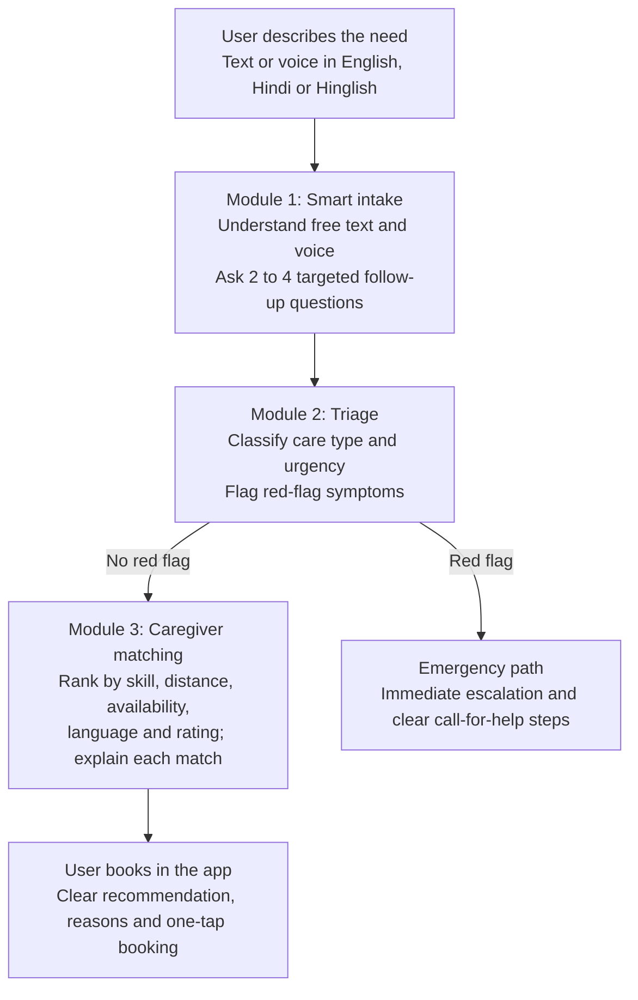

# CareCompass

**AI-powered care navigation and caregiver matching:** understand what a patient needs and connect them to the right caregiver, quickly and safely.

**HACK IIITD · CAI, IIIT-Delhi — AI Problem Statement**

| Department | Organiser | Track | Problem type |
|---|---|---|---|
| CAI (Centre for Artificial Intelligence), IIIT-Delhi | CAI, IIIT-Delhi | AI for Healthcare Access | NLP · Decision support · Ranking · UX |

This challenge focuses on helping users identify suitable care and connect with an appropriate caregiver.

## 01. Problem description

**Patients and families often cannot tell what kind of care they need.**

Some delay care until a problem becomes serious. Others reach the wrong provider, or rush to emergency for issues a home visit could handle. A home-healthcare app sees this at its front door: a user types or speaks a request, and the app has seconds to respond well.

> “Papa ko do din se bukhar hai aur khansi bhi.”
>
> “Father has had fever and cough for two days.” A typical Hinglish request the system must handle.

From a message like this, the app must decide three things:

| What care fits | How urgent it is | Who should go |
|---|---|---|
| Paramedic home visit, nurse, GP teleconsult, specialist, or emergency referral | Routine, same-day, or immediate | Best available caregiver by skill, distance, availability and language |

Today this triage is manual, slow and inconsistent. The challenge is to make it intelligent, multilingual and safe, while keeping the experience simple enough for any user, including elderly and low-literacy users.

## 02. Expected solution

Participants build an end-to-end system with three connected modules, wrapped in a simple app interface.

**Three modules take a user from symptoms to the right caregiver:**



**Any red-flag symptom skips matching and goes straight to the emergency path.**

| Module | Input | Output |
|---|---|---|
| 1. Smart intake | Free text or voice, plus conversation so far | Structured symptoms, or the next follow-up question |
| 2. Triage | Structured symptoms | Care type, urgency level, red flags, reasoning |
| 3. Caregiver matching | Care need, user location, caregiver profiles | Ranked caregivers with a reason for each match |

The interface should work for elderly and low-literacy users: minimal typing, voice support, and plain-language explanations.

## 03. Dataset and resources provided

All data is synthetic. No real patient data will be shared, in line with the Digital Personal Data Protection (DPDP) Act, 2023.

| Resource | What it contains | Use |
|---|---|---|
| Case vignettes (train) | Synthetic patient requests in English, Hindi and Hinglish, labelled by doctors with care type and urgency | Training and validation |
| Case vignettes (hidden test) | Held-back cases with the same labels, including edge cases and emergencies | Final scoring only |
| Caregiver profiles | Mock profiles: role, skills, location, availability slots, languages, ratings | Matching module |
| Care taxonomy | Definitions of each care type and urgency level, with example red-flag symptoms | Label reference |
| API schema | JSON input and output format every submission must follow | Integration and auto-scoring |
| Mentors | Sessions with CAI mentors and clinical/domain experts during the event | Domain guidance |

Teams may use any public medical or language datasets, provided they cite them in their write-up.

## 04. Deliverables

Submit a working prototype built **API-first**, so the strongest solutions can be adapted into a live app. A polished proof of concept is expected, not production code.

1. **REST API** that follows the published JSON schema. This is the most important deliverable: it makes integration and automated scoring possible.
2. **Demo interface:** a web or mobile front end showing the full journey, from symptom input to caregiver booking.
3. **Predictions file (CSV)** on the hidden test set, for objective scoring.
4. **GitHub repository** with a README and setup steps. A Dockerised setup is preferred.
5. **Short write-up** (2 pages max) covering approach, models used, safety logic and known limitations.
6. **Demo video** of 3 minutes or less.

### API contract (indicative)

The final schema will be shared with the dataset. Its shape:

**Request**

```json
{
  "user_input": "papa ko do din se bukhar hai aur khansi bhi",
  "language": "auto",
  "location": { "lat": 28.54, "lng": 77.27 },
  "conversation_history": []
}
```

**Response**

```json
{
  "follow_up_question": null,
  "care_type": "paramedic_home_visit",
  "urgency": "same_day",
  "red_flags": [],
  "reasoning": "Fever with cough for 2 days, no breathing difficulty reported",
  "matched_caregivers": [
    {
      "caregiver_id": "CG_014",
      "score": 0.92,
      "reason": "Hindi-speaking, 3 km away, free at 4 pm"
    }
  ]
}
```

When the system needs more information, it returns a `follow_up_question` instead of a final decision.

## 05. Evaluation criteria

Solutions are scored on a **100-point scale**.

| Criterion | Weight | How it is measured |
|---|---:|---|
| Routing accuracy | 30% | Macro-F1 on care type and urgency over the hidden test set |
| Safety | 20% | Recall on emergency and red-flag cases; under-triage is penalised heavily |
| Matching quality | 20% | Ranking quality of recommended caregivers against expert-judged best matches |
| UX and demo | 20% | Ease of use, multilingual and voice support, clarity of the end-to-end flow |
| Explainability | 10% | Clear, correct reasons shown for each routing and matching decision |

> **Safety first.** A system that misses emergencies cannot win, however accurate it is overall.

**Tie-breaks:** fewest follow-up questions needed to reach a correct decision, response time, and how easily the API could plug into a live app.

**Judging panel:** CAI faculty and healthcare-domain reviewers. Quantitative scores are computed automatically; the remaining criteria are scored during the final demo.

## 06. Rules and constraints

- **Tech stack:** open choice. Open-source models and affordable commercial APIs are both allowed; declare every model and API used.
- **Data handling:** use only the provided synthetic data and cited public datasets. Do not collect or upload real patient information.
- **Clinical scope:** the system supports routing decisions; it must not diagnose or prescribe. Emergency cases must always surface a clear call-for-help path.
- **Originality:** code must be written during the event. Pre-existing libraries and open-source components are fine with attribution.
- **Intellectual property:** Participants retain ownership of the code they create. CAI, IIIT-Delhi and the organising team may discuss future collaboration or other opportunities with teams separately; any such arrangement will be subject to mutually agreed terms.

> **To be confirmed before publishing:** event dates and duration, team size, prize pool, and final IP terms.
